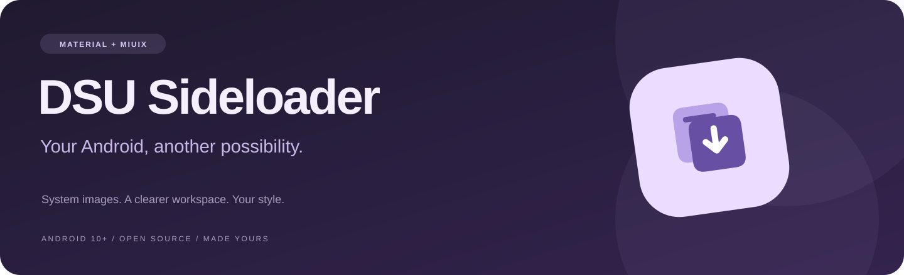
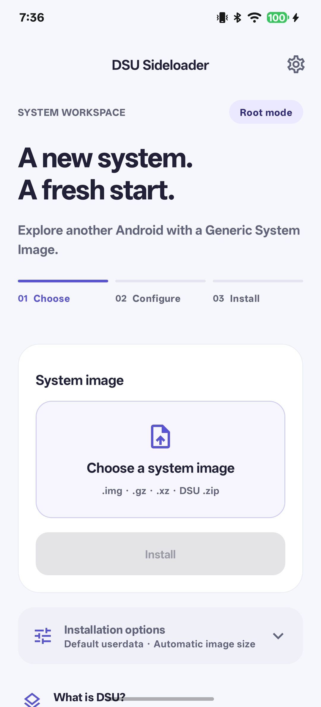
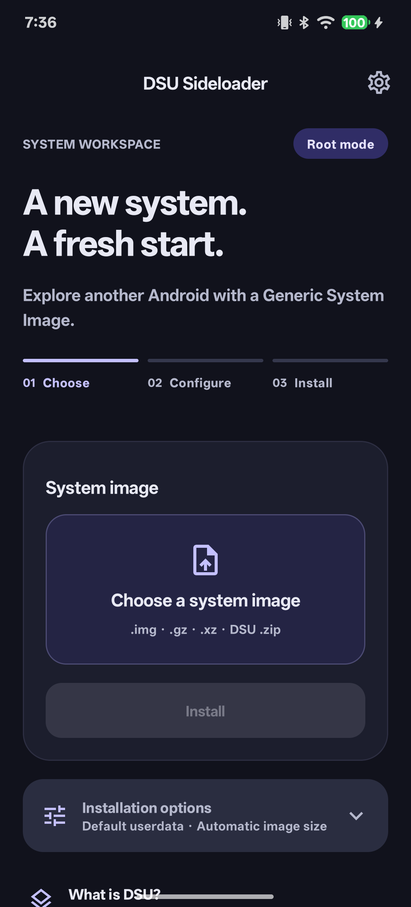
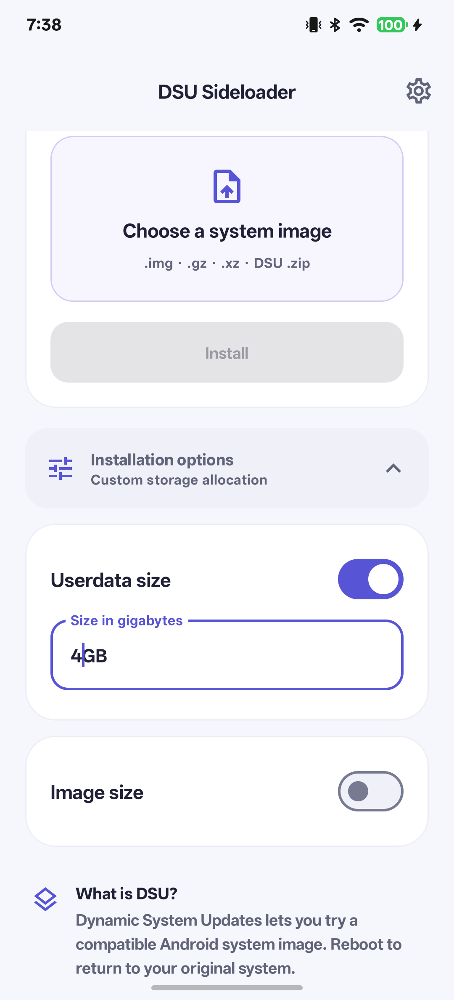
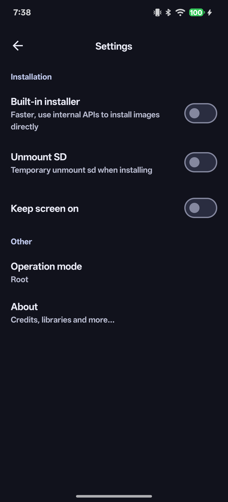

<p align="center">
  
</p>

<p align="center">
  A native Android workspace for trying Generic System Images.<br>
  Redesigned with Jetpack Compose, an indigo palette, and a clearer installation flow.
</p>

<p align="center">
  <a href="https://github.com/faridbtw/DSU-Sideloader/actions/workflows/android.yml"></a>
  
  
  <a href="LICENSE"></a>
</p>

<p align="center">
  <a href="#screenshots">Screenshots</a> &nbsp;·&nbsp;
  <a href="#get-a-build">Get a build</a> &nbsp;·&nbsp;
  <a href="#quick-start">Quick start</a> &nbsp;·&nbsp;
  <a href="#build-from-source">Build from source</a>
</p>

## A familiar tool, refreshed

Choose an image, adjust the options you need, and follow the installation. This fork gives DSU Sideloader a more focused interface while retaining the original installation engine and operation modes.

| A clearer workspace | Made for everyday use |
| --- | --- |
| **Compact install flow** — image selection and Install share one card; the full library opens in a scrollable dialog. | **Your appearance** — Real Material and Miuix interfaces, plus Cupertino-inspired and Minimal presets; light/dark/AMOLED modes, Monet, 15 key colors, and wallpaper colors. |
| **Your image library** — automatically lists supported images in the selected folder and its subfolders, with refresh and folder switching. | **Options when you need them** — expandable userdata and image-size controls. |
| **Visible progress** — a percentage when the installer provides one, plus logs and recovery actions. | **Consistent controls** — updated typography, rounded surfaces, and clearer button states. |

Switch between Material and the actual Miuix component library under **Settings → Appearance → Interface style**. Miuix supplies native cards, buttons, switches, text fields, top bars, dialogs, and dropdowns. Cupertino-inspired and Minimal remain appearance presets. Open **Theme** for mode, Monet, key color, nine palette variants, and the 2021/2025 color specifications. Unsupported 2025 palettes use 2021 while retaining your saved choice.

## Screenshots

Captured on a **OnePlus PJZ110**, running this fork (`2.03-design.1`). The options screen shows a sample 4 GB userdata allocation.

<table>
  <tr>
    <td align="center"><strong>Light workspace</strong><br><br></td>
    <td align="center"><strong>Dark workspace</strong><br><br></td>
  </tr>
  <tr>
    <td align="center"><strong>Installation options</strong><br><br></td>
    <td align="center"><strong>Settings</strong><br><br></td>
  </tr>
</table>

## Get a build

**[Open Android builds →](https://github.com/faridbtw/DSU-Sideloader/actions/workflows/android.yml)**

Choose a successful `master` run and download **DSU-Sideloader-redesign** from its **Artifacts** section. Extract the ZIP and install `app-debug.apk`. GitHub requires you to sign in to download workflow artifacts.

These are debug builds of this fork. They use the same package ID as the original app and a different signing key, so back up anything you need before uninstalling the original. The upstream F-Droid listing and upstream releases contain the original interface. The upstream in-app updater is disabled in this fork.

## Quick start

You need **Android 10 or newer**, a device with **dynamic partitions**, an **unlocked bootloader** for most community images, and a GSI compatible with your device architecture and vendor implementation.

1. Install the app and grant access to a folder for temporary image files.
2. Select an image from **System images**, or choose a file manually: `.img`, `.gz`, `.xz`, or a DSU package `.zip` on Android 11+.
3. Open **Installation options** if you need a custom userdata allocation. Leave image size automatic unless you know a manual value is needed.
4. Tap **Install**, review the confirmation, and follow the prompts for your operation mode.
5. When installation completes, use the app or Android’s DSU notification to boot the image.

Device support determines whether a GSI can install and boot. Successful builds and interface screenshots do not verify GSI boot compatibility. A normal reboot returns to the original system unless sticky mode is enabled.

<details>
<summary><strong>Which operation mode will the app use?</strong></summary>

The app detects the best available mode automatically.

| Mode | What it provides |
| --- | --- |
| **ADB** | Prepares the image and provides a command to start Android’s DSU installer. |
| **Shizuku** | Starts the system installer without a separate PC command; diagnostics depend on log permission. |
| **Root** | Adds DSU controls and the experimental built-in installer on supported Android versions. |
| **System / System + Root** | Uses the original project’s privileged module for additional integration. |

See the [original operation-mode documentation](docs/UPSTREAM.md#operation-modes) for details and limitations.

</details>

## Build from source

Use **JDK 21**, **Android SDK platform 37.0**, and **Build Tools 36.0.0**, then run:

```sh
git clone https://github.com/faridbtw/DSU-Sideloader.git
cd DSU-Sideloader
./gradlew testDebugUnitTest assembleDebug lintDebug
```

The APK is generated at `app/build/outputs/apk/debug/app-debug.apk`.

Android Studio previews for light mode, dark mode, and larger text are in [`WorkspacePreview.kt`](app/src/main/java/vegabobo/dsusideloader/ui/screen/home/WorkspacePreview.kt). New labels cover all six existing translated locales. The lint baseline records only 67 pre-existing translation gaps in upstream resources; new code and resources are still checked.

## Credits & license

This is an independent design fork by [faridbtw](https://github.com/faridbtw), based on [VegaBobo/DSU-Sideloader](https://github.com/VegaBobo/DSU-Sideloader). Original app icon and design reference by [WSTxda](https://github.com/WSTxda). Thanks to the original contributors and translators.

The appearance controls reference the behavior of [KowSU Pro](https://github.com/KOWX712/KernelSU). This fork independently implements those controls using [Miuix](https://github.com/miuix-kotlin-multiplatform/miuix) (Apache 2.0) and [MaterialKolor](https://github.com/jordond/MaterialKolor) (MIT).

Released under [Apache License 2.0](LICENSE). The [original project guide](docs/UPSTREAM.md) is preserved for reference.
